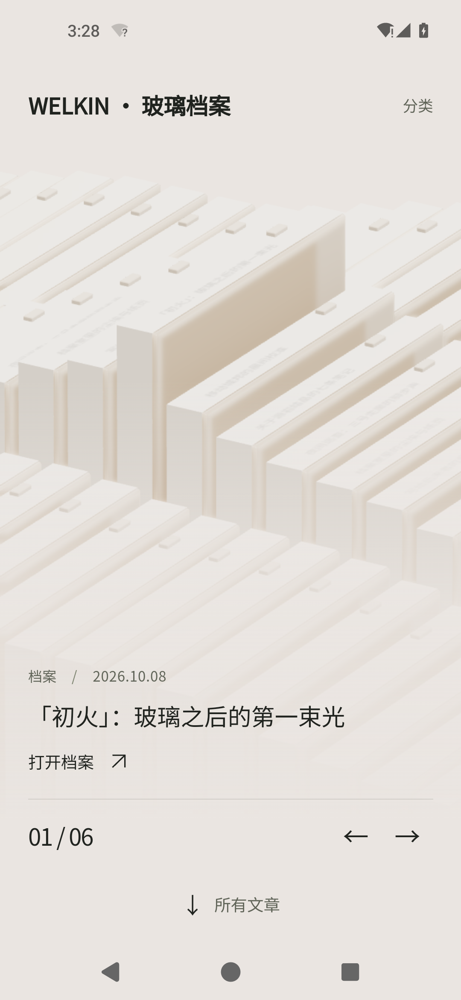
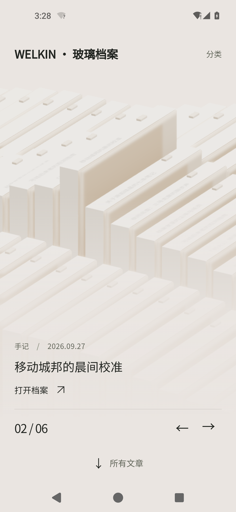
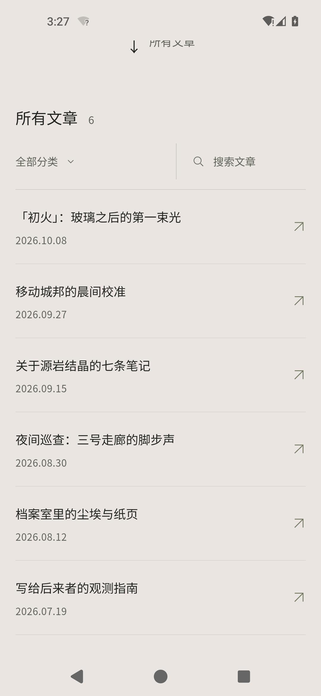
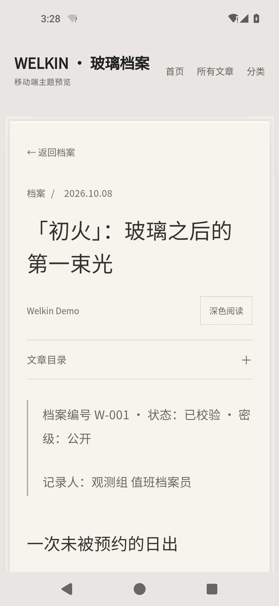
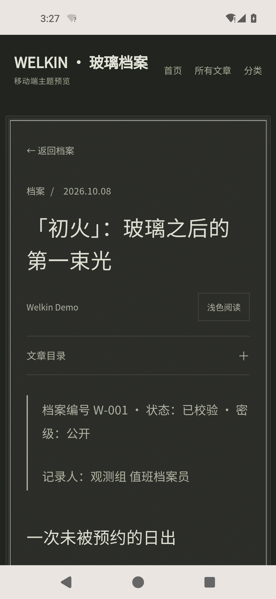

# Welkin-Android

把 [hexo-theme-welkin](https://github.com/ZenithSeraph/hexo-theme-welkin)（参考《明日方舟》档案风格的 Hexo 主题，MIT）打包成可以直接装进手机运行的 Android 应用：**Three.js 玻璃档案首页 + 纸页阅读界面**，站点资源全部内置，**离线可用**。

不只是套 WebView：阅读页的深色模式、文章目录、图片大图查看、档案切换都可以点，另外补了原生触感反馈、返回键回退与外链跳转。



## 下载与安装

- 安装包：[`Welkin-1.0.3.apk`](Welkin-1.0.3.apk)（约 0.67 MB，自签名）
- 包名 `com.welkin.archive`，最低 Android 7.0（API 24），目标 API 34
- SHA-256：`B21D2E92C35B6F6BEA560813851908DB1ADF7AB011A0AAED6E240D8A29629EE8`

把 APK 传到手机 → 点击安装 → 允许「未知来源」即可。应用只申请 `INTERNET`（创建 127.0.0.1 回环 socket 所需）与 `VIBRATE`（点击反馈）两个权限，不联网抓数据、无广告统计。

## 点击后会发生什么

| 位置 | 操作 | 效果 |
| --- | --- | --- |
| 首页玻璃档案 | 点 `→` / `←` | 切换档案，计数 `01/06 → 02/06`，玻璃文件重新排布 |
| 首页玻璃档案 | 上下滑动 / 滚轮 | 同样切换档案 |
| 首页 | 点「所有文章」 | 展开文章索引（搜索 + 分类筛选） |
| 索引 | 输入关键词 / 选分类 | 实时过滤（例：「城邦」剩 1 篇，分类「研究」剩 2 篇） |
| 索引 | 点条目 | 进入纸页文章页 |
| 文章页 | 点「文章目录」 | 展开目录锚点 |
| 文章页 | 点「深色阅读」 | 整页切换深色，状态本地记住 |
| 文章页 | 点正文插图 | 原生 `<dialog>` 大图查看，Esc/点空白关闭 |
| 任意外链 | 点按 | 交给系统浏览器，应用内不跳走 |
| 全局 | 每次点按 | 8ms 轻振动 |
| 全局 | 返回键 / 返回手势 | 站点内先回退，首页再退出 |

## 截图

| 切换档案 | 文章索引 |
| --- | --- |
|  |  |

| 纸页阅读 | 深色阅读 |
| --- | --- |
|  |  |

更多截图在 [`shots/`](shots/)。

## 实现原理

主题首页依赖 ES module、JSON import map 与 WebGL（`three.module.js`），`file:///android_asset` 这种源会被 CORS 挡住，import map 与模块都加载不了。所以：

1. **`android/app/src/main/java/com/welkin/archive/LocalServer.java`** —— 应用内置一个只监听 `127.0.0.1` 的极简 HTTP 服务（优先 8866 端口，被占用则随机端口）：从 `assets/www` 读字节、按扩展名给 MIME、目录补 `index.html`、拒绝 `..` 穿越、支持 HEAD；
2. **`MainActivity.java`** —— 单 Activity + WebView 加载 `http://127.0.0.1:<port>/`，注入点击监听调用 `WelkinNative.tap()` 触发振动，接管返回键，外链交给系统浏览器；启动或加载失败时显示可重试说明页，不闪退；
3. **站点** —— Hexo 8.1.2 + 主题原样生成，附加 6 篇原创演示文章、封面与 favicon。

构建不依赖 Gradle：`aapt2`（资源）→ `javac`（源码）→ `d8`（dex）→ 手动打包 assets → `zipalign -p` → `apksigner`。

### 两个值得记录的坑

- **`INTERNET` 权限**：Android 上创建任何 socket（包括 127.0.0.1 回环）都需要该权限，缺了会直接 `EPERM (Operation not permitted)`；
- **aapt2 的反斜杠**：Windows 版 aapt2 用 `-A` 打包 assets 时，会把子目录分隔符写成 `\`（`assets/www\2026\...`），而 AssetManager 只认 `/`，结果是应用里所有资源 404（页面只剩 `Not found: /index.html`）。本项目改为用 ZipArchive 以正斜杠路径自行写入，并在构建末尾强制校验：出现 `\` 条目、数量不符或缺 `index.html` 直接构建失败。

## 目录结构

```
Welkin-Android/
├─ Welkin-1.0.3.apk          可直接安装的包
├─ android/
│  ├─ build.ps1              无 Gradle 构建脚本（含 assets 校验）
│  └─ app/src/main/          AndroidManifest、Java 源码、res
├─ site/                     Hexo 站点工程（主题在 themes/welkin，public/ 为已生成站点）
├─ src/                      上游主题源码副本（保留 MIT 声明）
├─ tools/                    封面/图标生成、链接检查、严格 assets 检查、模拟器自动化脚本
├─ shots/                    交互与实机截图
└─ download/                 上游主题 tar 包
```

## 从源码构建

前置：Node.js ≥ 20.19、JDK 17、Android SDK（build-tools 34+、platform 35；模拟器测试另需 emulator 与 `system-images;android-34;default;x86_64`）。

```powershell
# 1) 生成静态站点
cd site
npm install
npx hexo clean
npx hexo generate

# 2) 打包 APK（在 ASCII 路径下编译，避开 aapt2 的中文路径问题）
pwsh -File ..\android\build.ps1
```

可选环境变量：`ANDROID_SDK_HOME`（SDK 根目录，默认自动探测）、`JAVA_HOME`（JDK 17）、`WELKIN_BUILD_DIR`（ASCII 编译暂存目录，默认 `%TEMP%\welkin-build`）。

> 首次构建会在暂存目录生成签名证书并回填到 `android/welkin-release.keystore`（已 gitignore）；想长期升级同一个包请保留它。

## 已验证

- **实机（模拟器）**：Android 14 / API 34、WebView 113.0.5672.136、1080×2340、WHPX 加速，**全新安装**后逐项点过：首页渲染、档案切换、索引、搜索/分类筛选、文章页、目录、深色阅读、返回键回退与退出，logcat 无 `FATAL EXCEPTION`；
- **自动化**：无头 Edge 点击 16 项、`LocalServer` 在 JVM 上 HTTP 18 项、严格模拟 AssetManager 规则检查 61 个资源与 40 个内部引用，全部通过；
- **安装包**：`apksigner verify`（v2/v3 签名）、`zipalign -c`、`aapt2 dump badging` 均通过。

## 已知问题

- 深色阅读时状态栏/导航栏仍是浅色（原生系统栏颜色未与网页联动），不影响使用；
- APK 使用自签名证书，仅适合侧载；上架应用商店需换成正式证书。

## 许可与致谢

- 本项目代码：MIT，见 [LICENSE](LICENSE)；
- 主题：[hexo-theme-welkin](https://github.com/ZenithSeraph/hexo-theme-welkin)，Copyright (c) 2026 ZenithSeraph，MIT。第三方声明（three.js、RhineLabUI 等）保留在 [`site/themes/welkin/THIRD_PARTY_NOTICES.md`](site/themes/welkin/THIRD_PARTY_NOTICES.md)；
- 演示文章、封面图、应用图标为本仓库生成的原创内容，仅作演示。
